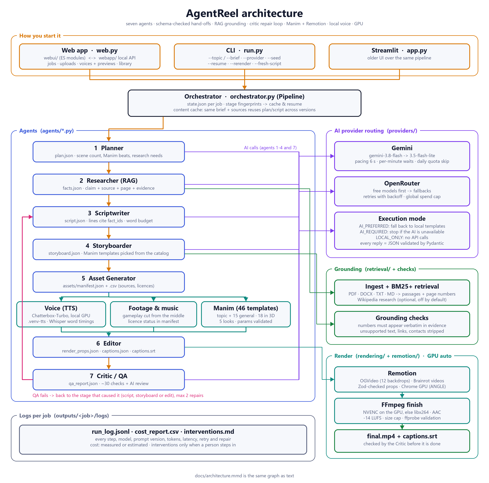

# AgentReel

AgentReel turns an arbitrary brief into a finished short video through a seven-agent pipeline, in one
of three visual personalities:

| Mode | What you get |
|---|---|
| **OG Mode** | Motion-graphics explainer: animated titles, key-point cards, stats, timelines, process and comparison scenes, charts from supplied data, and **Manim** animation clips, on an animated background with a palette picked per video. |
| **Minecraft Brainrot** | **Real Minecraft parkour gameplay** background + TTS narration + big word-synced captions with highlighted keywords, punch-in zooms and sway. |
| **Subway Brainrot** | **Real Subway Surfers gameplay** background with the same caption/narration engine and its own theme. |

**Remotion** composes and renders every video. **Manim** renders specialised clips that Remotion places
in the OG timeline. **FFmpeg/FFprobe** handle media preparation, loudness, final encoding and validation.
Python orchestrates everything. See [docs/architecture.png](docs/architecture.png).



---

## 1. Setup (Windows, tested)

Tested on Windows 11 with Python 3.12.5, Node 22.20, npm 11.11, FFmpeg/FFprobe 9.0 (gyan.dev build),
Remotion 4.0.531 and Manim CE 0.22.0. Python 3.11+ should work. No Docker, GPU or paid API is needed.

```powershell
git clone <your repo url> AgentReel
cd AgentReel
python -m venv .venv
.\.venv\Scripts\python.exe -m pip install -r requirements.txt
cd remotion; npm install; cd ..
copy .env.example .env            # then add GEMINI_API_KEY and/or OPENROUTER_API_KEY
.\.venv\Scripts\python.exe scripts\setup_gameplay_assets.py   # downloads + validates the gameplay clips
.\.venv\Scripts\python.exe run.py --status                     # toolchain + gameplay readiness
.\.venv\Scripts\python.exe web.py --provider gemini            # open the app
```

**What is not in the repository:** your `.env` keys, generated videos (`outputs/`), gameplay footage and the
previews/stills cut from it (the Minecraft and Subway Surfers clips are not verified as licensed for reuse, so
`setup_gameplay_assets.py` fetches them locally), and any PDFs or DOCX files. Without the gameplay clips the
Minecraft and Subway styles are disabled in the app; Motion graphics works out of the box.

FFmpeg and Node.js must be on `PATH`. Remotion downloads its headless Chrome on the first render.
LaTeX is **not** required (Manim templates use plain `Text`).

## 2. Run

**Web app (main UI)**

```powershell
.\.venv\Scripts\python.exe web.py                      # AI provider from .env
.\.venv\Scripts\python.exe web.py --provider gemini    # or openrouter; --port 8600, --no-browser
```

Opens http://127.0.0.1:8600 in your browser. It has four screens: Create (brief, attachments, style, length, type,
voice and more options), Rendering (live progress, including Remotion frame counts), Result (player, downloads,
new versions in another style or voice that reuse the script) and Library (every video, grouped by version).
It uses only the Python standard library for the server (`webapp/`: config, jobs, runner, library, voices, uploads,
system, server, app) and native ES modules in `webui/` (`js/screens`, `js/components`, `js/services`, `js/ui`,
`js/core`, plus one stylesheet per area in `css/`), so there is no build step.
It listens on 127.0.0.1 only. Dark and light themes are in the header.

**Streamlit UI (older)**

```powershell
.\.venv\Scripts\python.exe -m streamlit run app.py
```

Pick a mode, type any topic, optionally upload sources/narration/music, and press Generate. Progress
comes from the job's `state.json`; results show the video, MP4/SRT downloads, script, storyboard,
sources, asset manifest, QA report, model usage/cost, logs, and a "Restyle & re-render" form that
reuses the existing script/storyboard/narration.

**CLI**

```powershell
# any topic, no YAML needed
.\.venv\Scripts\python.exe run.py --topic "Why do cats purr?" --mode subway --duration 40

# YAML brief (see briefs/examples/)
.\.venv\Scripts\python.exe run.py --brief briefs\examples\procrastination.yaml --seed 42

# quick test render (small, short, labelled TEST in the QA report)
.\.venv\Scripts\python.exe run.py --brief briefs\examples\green_hydrogen.yaml --dev-short --local-only

# render from a user-supplied script/storyboard (no LLM needed)
.\.venv\Scripts\python.exe run.py --brief briefs\examples\green_hydrogen.yaml --local-only `
    --script-json briefs\examples\green_hydrogen_script.json `
    --storyboard-json briefs\examples\green_hydrogen_storyboard.json

.\.venv\Scripts\python.exe run.py --resume <JOB_ID>                       # continue a failed/interrupted job
.\.venv\Scripts\python.exe run.py --rerender <JOB_ID> --highlight-color "#FF3D7F" --caption-position lower
```

| Flag | Meaning |
|---|---|
| `--mode og\|minecraft\|subway` | override the brief's mode |
| `--seed N` | makes local choices (palette, gameplay cuts, clip order) reproducible; LLM output is not guaranteed identical |
| `--local-only` | `LOCAL_ONLY`: no LLM requests at all |
| `--ai-required` | `AI_REQUIRED`: fail clearly if the AI provider is unavailable |
| `--provider gemini\|openrouter` | which AI provider to use for this run |
| `--voice NAME` | Edge TTS voice, e.g. `en-IN-PrabhatNeural` (`--list-voices` lists them) |
| `--dev-short` | short test render at 540×960 (allowed below 30 s; never labelled as production) |
| `--resume JOB_ID` | rerun only stages whose inputs changed or that did not finish |
| `--rerender JOB_ID` | new caption style, same content |
| `--output-dir PATH` | where job folders go (default `outputs/`) |
| `--script-json / --storyboard-json` | supply your own validated script/storyboard |

Exit code is 0 when technical QA passes, 3 when it fails, 2 for an invalid brief.

## 3. Briefs

```yaml
id: demo_001
topic: Why do people procrastinate?        # anything; no fixed topic list
audience: College students
mode: minecraft                            # og | minecraft | subway
duration_s: 45                             # 30-60 for production; shorter only with dev_short: true
tone: engaging, conversational
language: English
subtitle_language: English
format: video_9x16                         # or video_16x9
content_type: factual_explainer            # promotional | awareness | fictional_story | general_entertainment | educational_story | opinion_commentary
must_include: []
must_avoid: []
cta: ""
source_files: [../sources/procrastination_notes.md]   # PDF, DOCX, TXT, MD (relative to the YAML)
source_text: ""                            # optional pasted source text
narration_audio: ""                        # optional: your own narration instead of TTS
music: ""                                  # optional: a track you are licensed to use
```

Every field is validated (Pydantic, `extra="forbid"`) before a job starts.

## 4. How it works

| # | Agent (`agents/`) | Output | LLM? | Local fallback |
|---|---|---|---|---|
| 1 | Planner | `plan.json` | yes | structure by content type, mode and duration |
| 2 | Researcher / RAG | `facts.json` | proposes claims | BM25+ retrieval over supplied docs; quotes source sentences |
| 3 | Scriptwriter | `script.md`, `script.json` | yes | simple templates (honestly limited) |
| 4 | Storyboarder | `storyboard.json` | yes (OG) | deterministic scene mapping |
| 5 | Asset Generator | `assets/manifest.json/.csv`, audio, Manim clips, gameplay background | no | – |
| 6 | Editor | `render_props.json`, `captions.json`, `captions.srt`, `final.mp4` | no | – |
| 7 | Critic / QA | `qa_report.json` | optional semantic review | deterministic checks |

* **Grounding.** The Researcher only uses supplied documents/text (plus an optional Wikipedia
  adapter, off by default). Every LLM-proposed claim is re-checked against the source text; numbers
  must appear verbatim in the evidence. Claims without evidence are marked `unsupported` and the
  Scriptwriter/Critic block them. Without sources, factual videos stay general and say so in the
  limitations.
* **Manim templates** (`manim/templates/`): process diagram, flow diagram, timeline, chart, step-by-step
  equation, chemical reaction, array algorithm (sorting/searching run for real on the given numbers), AI agent
  loop with tools, cybersecurity attack/defence flow, function graph (safe math parser, never eval), line chart,
  donut chart and node/network graph. The storyboarder picks one when the topic fits.
* **Backgrounds** (Remotion): orbs, grid, waves, rays, shapes, aurora, constellation, hexgrid, circuit, contours,
  stripes and matrix, chosen per scene to match its mood and never the same twice in a row.
* **No generated code runs.** Storyboards are parameters for known Remotion components and trusted
  Manim templates; both sides validate (Pydantic in Python, Zod in Remotion). Subprocesses use argument
  lists; paths are sanitised; uploads are type- and size-checked (50 MB).
* **Timing from measured audio.** Narration is synthesised per chunk; each chunk's real duration is
  measured with ffprobe. Captions use Edge TTS word boundaries (phrase captions built from real word
  timings). If a backend gives no word timings, a chunk's *measured* duration is shared among its
  phrases (flagged in QA); the total video length is never simply split evenly.
* **Remotion rendering.** Media is hard-linked into the job's `public/` folder and passed with
  `--public-dir`; compositions use `staticFile()`; props go in a JSON file (`--props=`).
  `calculateMetadata` parses props with Zod and sets size/fps/duration.
* **Finishing.** Two-pass FFmpeg `loudnorm` to about -14 LUFS, H.264 `yuv420p`, AAC 48 kHz stereo
  160 kbps, 30 fps CFR, `+faststart`, re-encode with a computed bitrate if the file exceeds 100 MB.
* **QA + repair.** ~30 checks (codec, resolution, fps, duration, black frames, loudness, caption
  ranges, captions == narration, SRT, readable size, scene coverage, assets present, gameplay
  provenance, unsupported claims, must_avoid, topic coverage, logs). Failures route to the
  responsible stage; at most `MAX_REPAIR_ATTEMPTS` (default 2) repairs, and deterministic local
  stages are not pointlessly re-run. A *technical pass* is reported separately from *semantic
  approval* (which needs an LLM; otherwise `not_reviewed`).
* **Caching/resume.** Each stage stores an input fingerprint in `state.json`; a stage is reused only
  if it finished, its artifacts exist and its inputs are unchanged. TTS chunks and gameplay
  backgrounds are cached by content hash within the job.

### Job folder

```
outputs/<job-id>/
  brief.json brief.yaml state.json plan.json facts.json retrieval_index.json
  script.md script.json storyboard.json captions.json captions.srt render_props.json
  final.mp4 qa_report.json
  inputs/        copied uploads / preset script+storyboard
  public/        Remotion public dir for this job (hard links)
  render/        remotion_raw.mp4, finish.json (loudness, checksum)
  assets/        manifest.json, manifest.csv, audio/, manim/, background_*.mp4
  logs/          run_log.jsonl, cost_report.csv, interventions.md
```

## 5. AI providers

Two providers are supported. Pick one per run with `--provider gemini|openrouter` on `web.py` or `run.py`,
or set `LLM_PROVIDER` in `.env`.

**Gemini** (free key from Google AI Studio):

```
GEMINI_API_KEY=...
GEMINI_MODEL=gemini-3.8-flash
GEMINI_FALLBACK_MODELS=gemini-3.5-flash-lite
GEMINI_MIN_INTERVAL_S=6        # free tier: at most 10 requests a minute
```

Requests are paced, per-minute limits are waited out, and a model whose daily free quota is used up is skipped
until midnight Pacific time.

**OpenRouter:**

```
OPENROUTER_API_KEY=...
OPENROUTER_MODEL=openrouter/free
OPENROUTER_FALLBACK_MODELS=google/gemma-4-31b-it:free,nvidia/nemotron-3-super-120b-a12b:free
ALLOW_PAID_MODELS=false
MAX_API_SPEND_USD=5
AGENTREEL_EXECUTION_MODE=AI_PREFERRED     # LOCAL_ONLY | AI_REQUIRED
```

* Models are tried in order. A model is used only if it is free per OpenRouter's `/models` pricing,
  or if `ALLOW_PAID_MODELS=true`; unknown prices count as paid. Free model IDs change over time, so
  check https://openrouter.ai/models and edit `.env`, not code.
* 429/5xx/timeouts/network: bounded exponential backoff with jitter (honours `Retry-After`), then the
  next model. 400/404: next model immediately. 401: stop. 402 (credits/quota): stop, never retried.
* Replies are parsed as JSON and validated with Pydantic; one bounded repair prompt per model.
* Every call is logged (model, prompt version, tokens, latency, retries, status). Cost uses OpenRouter's
  `usage.cost` (`measured`), else pricing × tokens (`estimated`), else `unknown`. A global ledger
  (`outputs/.spend_ledger.json`) enforces `MAX_API_SPEND_USD`.
* The LLM is used for planning, claim synthesis, scripting, storyboarding and semantic review only;
  timing, rendering and validation are deterministic.

## 6. Gameplay footage

`python scripts/setup_gameplay_assets.py` downloads the sources listed in
`assets/gameplay_sources.yaml` (resumable, never re-downloads a valid file), validates them
(ffprobe + decode test + SHA-256) and records provenance in `assets/manifest.csv`. Brainrot modes
refuse to render without a usable clip of the right game; nothing is ever substituted.

| Clip | Source | Status | Notes |
|---|---|---|---|
| `assets/gameplay/minecraft/parkour.mp4` (1280×720, 363 s) | Internet Archive item `il-mio-parkour-su-minecraft-vinci-teo-00-yt` | **needs_review** | Real Minecraft parkour. Item states CC0; description is first-person and the in-game name "VinciTeo00" matches the stated creator, but the uploader cannot be independently verified. Intro, menus, a death screen and the outro are excluded via `usable_ranges`. |
| `assets/gameplay/subway/subway_surfers.mp4` (720×1278, 193 s) | Internet Archive item `subway-surfers-2024-gameplay-4-k-9x-16-no-copyright-1` | **needs_review** | Real Subway Surfers gameplay. Appears to be a re-upload of a "No Copyright" YouTube compilation; that label is not proof of permission and SYBO publishes no gameplay-video policy. Treat as local test footage. |

Neither clip is marked `verified`. Before publishing, replace them with footage you recorded yourself
or have written permission for:

```powershell
python scripts/setup_gameplay_assets.py --game subway --register D:\recordings\my_run.mp4 `
    --creator "me" --license "own recording" --review-status verified --usable-ranges "5-170"
python scripts/setup_gameplay_assets.py --game minecraft --url https://example.com/authorised.mp4 `
    --creator "..." --license "..." --permission-url "..."
python scripts/setup_gameplay_assets.py --status
```

Backgrounds are built per video with FFmpeg: clips from the middle 70 % of each usable range,
a new stretch every 4–7 s with short crossfades, cover-scaled and centre-cropped to 9:16 (or 16:9)
without distortion, looped/concatenated as needed, audio muted.

## 7. Tests

```powershell
.\.venv\Scripts\python.exe -m pytest -m "not slow"   # fast unit/integration tests
.\.venv\Scripts\python.exe -m pytest -m slow         # real Manim + Remotion + FFmpeg renders
cd remotion; npx vitest run; npx tsc --noEmit
```

The failure-path tests (429, fallback, 402, invalid JSON, spend cap, paid-model blocking) use a mocked
HTTP transport, so they never call or pay for the real API. The synthetic test pattern used in a few
renderer unit tests is labelled as such and is never counted as a gameplay test.

## 8. Known limitations

* Free AI tiers run out: OpenRouter's free models allow about 50 requests a day, and Gemini's main free model
  about 20. The backup model writes shorter scripts, which can leave a video under 30 s.
* Without an LLM, scripts come from simple templates. They are honest but generic; for good results
  offline, supply sources and/or your own `--script-json`.
* Gameplay permission is `needs_review` for both bundled clips (see above).
* Edge TTS needs internet; offline, the Windows SAPI voice is used (no word timings, so captions are
  aligned within each measured chunk instead).
* Word-by-word karaoke highlighting is not implemented; captions are short phrases timed from real
  word boundaries, with keyword highlights.
* Online research (Wikipedia) is optional and off by default; it needs `AGENTREEL_CONTACT` for the
  Wikimedia User-Agent policy.
